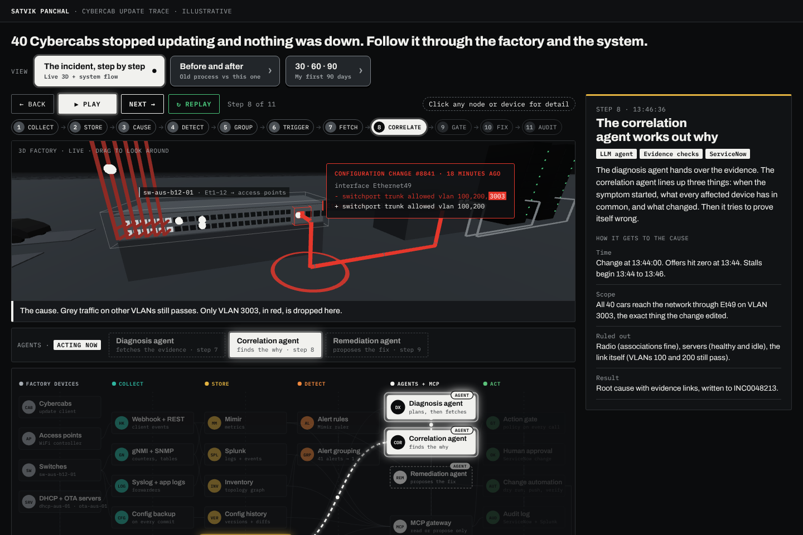
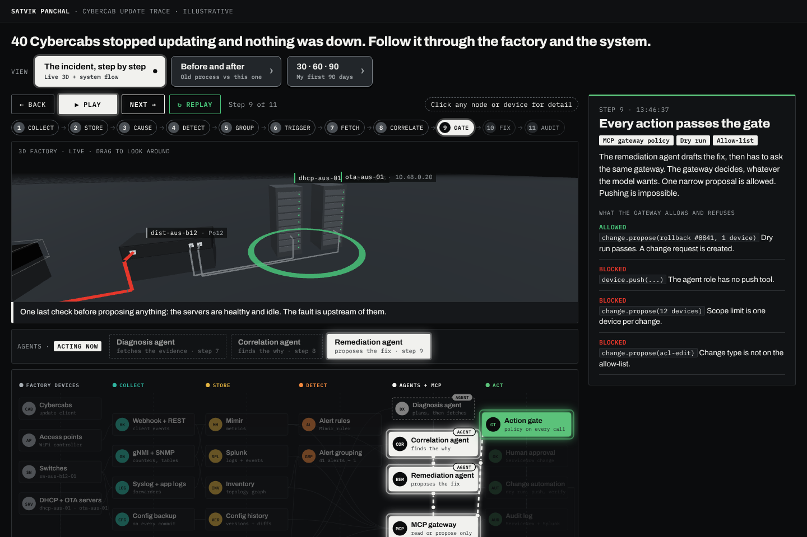
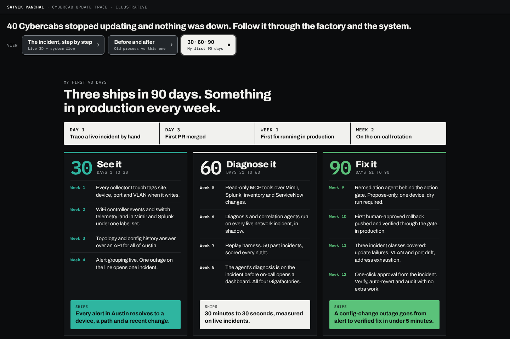

# Network Incident Trace

An interactive 3D walkthrough of an agentic system diagnosing a factory network outage, from raw telemetry to a human-approved fix.

**Live demo:** https://network-incident-trace.vercel.app/

## The scenario

40 Cybercabs on a factory line can't finish a software update. Nothing is down. A routine config change removed their VLAN from one switch uplink 18 minutes earlier.

The demo follows that incident in 11 steps: collect, store, cause, detect, group, trigger, fetch, correlate, gate, fix, audit. A 3D factory and a system diagram stay in sync at every step.

Agents read through MCP tools and can only propose a change. A person approves it, automation pushes it, and telemetry verifies it.

## Run it

Open `index.html` in a browser. It is one self-contained file and works offline.

## Built with

Three.js, SVG, and plain HTML, CSS, and JavaScript. Hosted on Vercel.

## Note

This is a front-end simulation. Device names, queries, timings, and tooling are illustrative. It is a personal project and is not affiliated with Tesla.

Satvik Panchal
